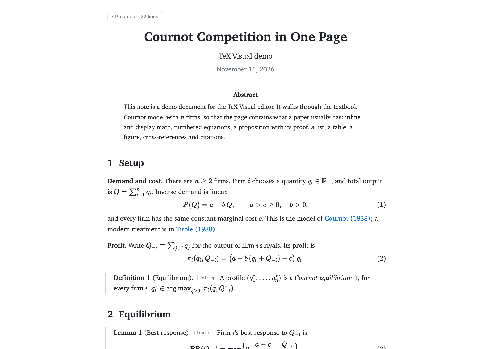
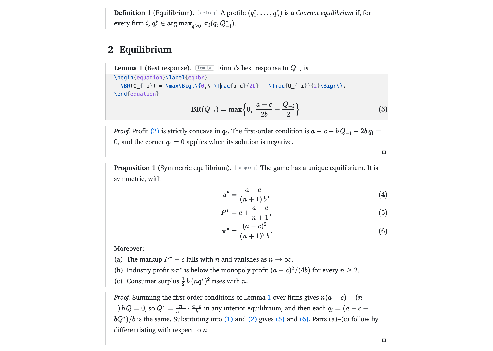
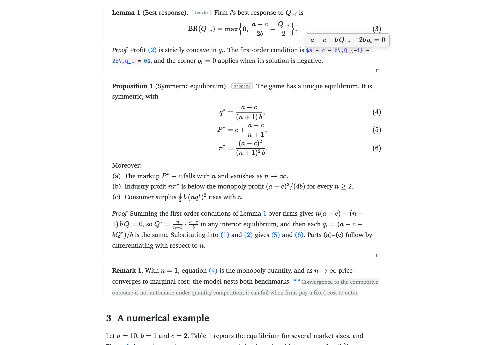

# TeX Visual

[](https://github.com/hugosantanna/tex-visual/actions/workflows/ci.yml)

A visual editor for LaTeX in VS Code, in the style of Overleaf's Visual Editor. You edit the real
`.tex` source, and everything the cursor is not touching is shown rendered: math, headings,
theorems, tables, figures, references and citations. Nothing is compiled, so it updates on every
keystroke.



Put the cursor in a formula and you get its source back, with a live preview that follows your
typing:



Inline formulas do the same with a preview bubble above the cursor:



## Install

TeX Visual is not on the Marketplace yet. Install the packaged extension from the latest release:

```sh
curl -fLO https://github.com/hugosantanna/tex-visual/releases/latest/download/tex-visual.vsix
code --install-extension tex-visual.vsix
```

Then run **Developer: Reload Window**. To update, run the same two commands again.

- **No terminal:** download `tex-visual.vsix` from the
  [latest release](https://github.com/hugosantanna/tex-visual/releases/latest), open the Extensions
  view, click `⋯` and choose **Install from VSIX…**
- **Cursor, VSCodium, Windsurf:** same commands with `cursor` or `codium` in place of `code`.
- **Windows (PowerShell):** `curl.exe -fLO <same URL>`, then the same `code` command.

Requires VS Code 1.90 or newer. It works alongside
[LaTeX Workshop](https://github.com/James-Yu/LaTeX-Workshop), which you still want for
compiling; neither needs the other.

## Use

Open any `.tex` file and press `Cmd+Shift+V` (`Ctrl+Shift+V` on Windows and Linux). The same
shortcut switches back to the plain text editor.

| | |
|---|---|
| `Cmd+Shift+V` | switch the current tab between text and visual editor |
| `Cmd+K V` | open the visual editor beside the source, scroll-synced both ways |
| `</>` button in the title bar | show raw source inside the visual editor |
| click on anything rendered | reveal its source and edit it |
| `Cmd+click` a reference or citation | jump to its label or bibliography entry |
| `Cmd+B`, `Cmd+I` | wrap the selection in `\textbf{}`, `\emph{}` |
| `Enter` after `\begin{env}` | inserts the matching `\end{env}` |
| `Cmd+F` | search |

There is a demo paper in [`examples/demo.tex`](examples/demo.tex) that exercises everything
below.

To make the visual editor the default for `.tex` files, add this to your settings:

```json
"workbench.editorAssociations": { "*.tex": "texVisual.editor" }
```

## What gets rendered

- **Math.** `$…$`, `\(…\)`, `\[…\]`, `$$…$$`, `equation`, `align`, `gather`, `alignat`, `multline`
  and their starred forms, through KaTeX. Your `\newcommand`, `\def`, `\DeclareMathOperator` and
  `\DeclarePairedDelimiter` definitions are picked up from the preamble, including the preamble of
  the root file when you are editing an `\input` file.
- **Numbering.** Sections, equations (per row in `align`), theorem-like environments from
  `\newtheorem` (shared and section-wise counters included), figures, tables and `enumerate`
  items are numbered from the file itself. `\ref`, `\eqref`, `\cref` and `\autoref` show those
  numbers and update the moment you add or move something. Labels defined in other files fall back
  to the `.aux` file of the last build.
- **Citations.** `\citet`, `\citep`, `\cite`, `\textcite`, `\parencite` and friends show
  author–year text, read from your `.bib` files or from `\bibitem` entries.
- **Structure.** `\title`/`\author`/`\date` at `\maketitle`, `abstract`, sectioning commands,
  `\paragraph`, theorem and `proof` environments, `itemize`/`enumerate`/`description`, footnotes,
  `\emph`, `\textbf`, `\texttt`, `\textsc`, `\underline`, `\href`, `\url`.
- **Floats.** `tabular` (with `booktabs` rules and `\multicolumn`) as a table,
  `\includegraphics` for PDF, PNG and JPEG files, and numbered captions.
- **Typography.** `~`, `--`, `---`, TeX quotes, accents such as `\"o` and `\'e`, and escaped
  characters are shown as the characters they produce.

Anything it does not understand is left as source, dimmed.

## How it works

The editor is a VS Code *custom text editor*: a webview running
[CodeMirror 6](https://codemirror.net), with decorations that replace source ranges by rendered
widgets (Overleaf's editor is built on CodeMirror 6 too). The VS Code text document stays the
single source of truth:

- Edits in the visual editor are applied to the document as ordinary text edits, so saving,
  undo/redo, hot exit, build-on-save and source control behave exactly as in the text editor.
- Changes made anywhere else (a text editor on the same file, a formatter, `git checkout`, an AI
  assistant) appear in the visual editor immediately. Concurrent edits are rebased rather than
  overwritten.

There is no TeX run involved. A small scanner in [`src/webview/latex.js`](src/webview/latex.js)
tokenizes the file on each change (a couple of milliseconds for a typical paper) and
[`src/webview/decorate.js`](src/webview/decorate.js) decides what to draw.

## Settings

| Setting | Default | |
|---|---|---|
| `texVisual.fontSize` | `16` | body font size in pixels |
| `texVisual.fontFamily` | `""` | CSS `font-family` for body text (default: Charter, Palatino, Georgia) |
| `texVisual.maxWidth` | `46` | width of the text column, in rem |
| `texVisual.followCursor` | `true` | keep the visual editor and a text editor on the same file scrolled together |

Colors follow your VS Code theme, light or dark.

## Limitations

- It is a fast approximation of your document, not the typeset result. Packages that change layout
  are ignored, and page breaks, floats placement and fonts are not those of the PDF.
- Math is limited to what [KaTeX supports](https://katex.org/docs/supported.html). A formula it
  cannot parse is shown in red with the error as a tooltip. Macros with optional arguments are
  rendered with their default value.
- TikZ, `verbatim`, listings and algorithm environments stay as source.
- Tables are rendered read-only; click one to edit its source.
- LaTeX Workshop's IntelliSense does not reach into the visual editor. Completion there covers
  `\ref{…}` and `\cite{…}` keys only.
- Developed and tested on macOS. Nothing in it is platform-specific, but Windows and Linux have
  had less use; please [open an issue](https://github.com/hugosantanna/tex-visual/issues) if
  something misbehaves.

## Development

```sh
git clone https://github.com/hugosantanna/tex-visual
cd tex-visual
npm install
npm run install-local      # build, package, and install into your VS Code
```

| | |
|---|---|
| `npm run build` | bundle the webview into `media/` |
| `npm test` | scanner unit tests, then a headless-Chrome render of the demo paper and a 1,500-step random-edit fuzz test (needs Chrome, Chromium or Edge; set `CHROME_PATH` if needed) |
| `npm run test:e2e` | macOS: runs the sync tests inside a throwaway VS Code instance |
| `node test/shot.mjs paper.tex out/` | screenshot any `.tex` file as the editor would render it |

Releases are cut by pushing a tag: `npm version patch && git push --follow-tags` builds the
`.vsix` in CI and attaches it to a GitHub release.

## License

[MIT](LICENSE). Bundled third-party software is listed in
[THIRD-PARTY-NOTICES.md](THIRD-PARTY-NOTICES.md). Not affiliated with Overleaf.
